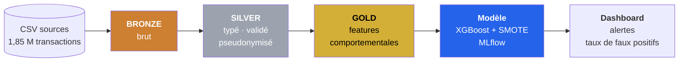

# Plateforme de détection de fraude bancaire

Pipeline de données de bout en bout sur **Databricks** : ingestion de 1,85 M de transactions, architecture **Medallion** (Bronze / Silver / Gold) en **Delta Lake**, feature engineering comportemental en **PySpark**, scoring **XGBoost + SMOTE** suivi dans **MLflow**, et dashboard des alertes.

> Projet Data Engineering support du mémoire MIA26 — *Améliorer la détection des fraudes tout en minimisant les faux positifs en environnement Big Data*.

---

## La problématique en une ligne

Détecter davantage de fraudes est facile — il suffit d'abaisser le seuil. **Le vrai problème est de le faire sans noyer les analystes sous les fausses alertes.** Ce projet traite le taux de faux positifs comme le KPI central, pas comme un effet de bord.

## Architecture



Détail des couches, décisions d'architecture et contraintes anti-fuite : **[docs/architecture.md](docs/architecture.md)**

## Stack

`Databricks` · `PySpark` · `Delta Lake` · `Unity Catalog` · `Spark SQL` · `MLflow` · `XGBoost` · `imbalanced-learn (SMOTE)` · `SHAP` · `Databricks Workflows` · `Databricks SQL`

## Le jeu de données

**Credit Card Transactions Fraud Detection** (Sparkov, Kaggle) — transactions simulées, aucune donnée personnelle réelle.

| | Entraînement | Test | Total |
| --- | ---: | ---: | ---: |
| Transactions | 1 296 675 | 555 719 | **1 852 394** |
| Fraudes | 7 506 | 2 145 | **9 651** |
| Taux de fraude | 0,579 % | 0,386 % | **0,521 %** |
| Période | 01/2019 → 06/2020 | 06/2020 → 12/2020 | 24 mois |

La séparation train/test est **temporelle et sans chevauchement** — condition indispensable pour une évaluation honnête en détection de fraude.

Récupération des données : [data/README.md](data/README.md)

## Résultats

> ⏳ *En cours — cette section sera remplie avec les métriques réelles à l'issue de l'étape 5.*

| Métrique | Valeur |
| --- | --- |
| AUC-ROC | — |
| AUC-PR | — |
| Précision | — |
| Rappel | — |
| F1 | — |
| **Taux de faux positifs** | — |
| Seuil de décision retenu | — |

## Avancement

| Étape | Livrable | État |
| --- | --- | :---: |
| 0 — Mise en place | Structure du dépôt, acquisition et profilage des données | ✅ |
| 1 — Bronze | Ingestion Delta fidèle à la source | ⏳ |
| 2 — Silver | Typage, contrôles qualité, pseudonymisation RGPD | ⏳ |
| 3 — Gold | Variables comportementales (window functions) | ⏳ |
| 4 — Modèle | XGBoost + SMOTE, comparaison, seuil, SHAP | ⏳ |
| 5 — Scoring | Table scorée et métriques d'évaluation | ⏳ |
| 6 — Orchestration | Databricks Workflow planifié | ⏳ |
| 7 — Dashboard | Alertes et suivi du taux de faux positifs | ⏳ |
| 8 — Streaming *(bonus)* | Auto Loader + Structured Streaming | ⏳ |

## Documentation

Chaque étape fait l'objet d'une note expliquant les choix techniques et leur justification — voir **[docs/memoire/](docs/memoire/README.md)**.

Deux notes disponibles à ce stade :

- **[00 — Contexte et choix des données](docs/memoire/00_contexte_et_donnees.md)** — pourquoi un corpus public, comparaison de trois jeux de données candidats, position RGPD.
- **[01 — Profilage initial](docs/memoire/01_profilage_initial.md)** — sept constats mesurés qui spécifient le pipeline, dont une incohérence de données détectée par contrôle croisé et une variable préconisée puis écartée sur preuve.

## Structure du dépôt

```
fraud-detection-pipeline/
├── docs/
│   ├── architecture.md          # architecture, décisions, contraintes anti-fuite
│   └── memoire/                 # notes justificatives par étape (FR)
├── data/                        # jeu de données (non versionné)
├── notebooks/                   # 01_bronze → 05_scoring, exécutés sur Databricks
├── src/fraud/                   # code réutilisable et testable
│   └── config.py                # nomenclature Unity Catalog centralisée
├── scripts/
│   ├── download_dataset.ps1     # acquisition reproductible des données
│   └── profile_dataset.py       # profilage — produit les chiffres des notes
├── tests/                       # tests unitaires des fonctions de src/
├── workflows/                   # définition du job Databricks orchestré
├── dashboards/                  # requêtes SQL et captures du dashboard
└── requirements.txt
```

## Reproduire le projet

```bash
# 1. Récupérer les données (compte Kaggle requis)
pip install kaggle
./scripts/download_dataset.ps1

# 2. Vérifier le profilage (produit tous les chiffres cités dans les notes)
python scripts/profile_dataset.py
```

Le pipeline lui-même s'exécute sur un workspace [Databricks Free Edition](https://www.databricks.com/learn/free-edition) : importer le dépôt via **Git Folders**, puis exécuter les notebooks dans l'ordre.

---

**Auteur** — Mouad AOUGHANE · Mémoire MIA26
