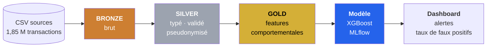

# Plateforme de détection de fraude bancaire

Pipeline de données de bout en bout sur **Databricks** : ingestion de 1,85 M de transactions, architecture **Medallion** (Bronze / Silver / Gold) en **Delta Lake**, feature engineering comportemental en **PySpark**, scoring **XGBoost** suivi dans **MLflow**, et dashboard des alertes.

> Projet Data Engineering support du mémoire MIA26 — *Améliorer la détection des fraudes tout en minimisant les faux positifs en environnement Big Data*.

---

## La problématique en une ligne

Détecter davantage de fraudes est facile — il suffit d'abaisser le seuil. **Le vrai problème est de le faire sans noyer les analystes sous les fausses alertes.** Ce projet traite le taux de faux positifs comme le KPI central, pas comme un effet de bord.

## Architecture



Détail des couches, décisions d'architecture et contraintes anti-fuite : **[docs/architecture.md](docs/architecture.md)**

## Stack

`Databricks` · `PySpark` · `Delta Lake` · `Unity Catalog` · `Spark SQL` · `MLflow` · `XGBoost` · `LightGBM` · `imbalanced-learn (SMOTE, testé puis écarté)` · `SHAP` · `Databricks Workflows` · `Databricks SQL`

## Le jeu de données

**Credit Card Transactions Fraud Detection** (Sparkov, Kaggle) — transactions simulées, aucune donnée personnelle réelle.

| | Entraînement | Test | Total |
| --- | ---: | ---: | ---: |
| Transactions | 1 296 675 | 555 719 | **1 852 394** |
| Fraudes | 7 506 | 2 145 | **9 651** |
| Taux de fraude | 0,579 % | 0,386 % | **0,521 %** |
| Période | 01/2019 → 06/2020 | 06/2020 → 12/2020 | 24 mois |

La séparation train/test est **temporelle et sans chevauchement** — condition indispensable pour une évaluation honnête en détection de fraude.

Récupération des données : [data/README.md](data/README.md)

## Résultats

Mesurés sur le **bloc de test** — 555 719 transactions du dernier semestre 2020, jamais consultées avant l'évaluation finale.

| Métrique | Valeur |
| --- | --- |
| AUC-ROC | 0,9991 |
| AUC-PR | 0,9671 |
| Précision | 0,7711 |
| Rappel | **0,9548** |
| F1 | 0,8532 |
| **Taux de faux positifs** | **0,110 %** |
| Seuil de décision retenu | 0,0380 — par minimisation du coût métier |

**2 048 fraudes détectées sur 2 145**, pour **608 fausses alertes** sur 553 574 transactions légitimes — soit **1,3 alerte examinée par fraude trouvée**.

> ⚠️ Corpus simulé : ces valeurs constituent une borne supérieure optimiste. Un système réel se situe plutôt entre 0,4 et 0,7 d'AUC-PR. Elles servent à comparer les configurations entre elles, non à promettre une performance en production.

## Avancement

| Étape | Livrable | État |
| --- | --- | :---: |
| 0 — Mise en place | Structure du dépôt, acquisition et profilage des données | ✅ |
| 1 — Bronze | Ingestion Delta fidèle à la source — 1 852 394 lignes réconciliées | ✅ |
| 2 — Silver | Typage, contrôles qualité, pseudonymisation RGPD — 0 % de rejet, 116 389 codes postaux réparés | ✅ |
| 3 — Gold | Variables comportementales (window functions) — 20 variables, 0 fuite temporelle | ✅ |
| 4 — Modèle | Découpage chronologique, 12 combinaisons comparées, MLflow — XGBoost retenu | ✅ |
| 5 — Scoring | Seuil par coût métier, SHAP, évaluation finale — **TFP 0,110 %** | ✅ |
| 6 — Orchestration | Databricks Workflow — 2 jobs séparés, chaîne complète en **5 min 15** | ✅ |
| 7 — Dashboard | Tableau de bord versionné — 9 visualisations, importable en un fichier | ✅ |
| 8 — Streaming *(bonus)* | Auto Loader, Silver en flux, profil client + jointure flux/statique | 🔨 |

## Documentation

Chaque étape fait l'objet d'une note expliquant les choix techniques et leur justification — voir **[docs/memoire/](docs/memoire/README.md)**.

Notes disponibles à ce stade :

- **[00 — Contexte et choix des données](docs/memoire/00_contexte_et_donnees.md)** — pourquoi un corpus public, comparaison de trois jeux de données candidats, position RGPD.
- **[01 — Profilage initial](docs/memoire/01_profilage_initial.md)** — sept constats mesurés qui spécifient le pipeline, dont une incohérence de données détectée par contrôle croisé et une variable préconisée puis écartée sur preuve.
- **[02 — Ingestion Bronze](docs/memoire/02_ingestion_bronze.md)** — schéma explicite, validation d'en-tête, idempotence et non-partitionnement justifié.
- **[03 — Qualité et conformité Silver](docs/memoire/03_qualite_silver.md)** — règles de qualité et quarantaine, réparation des codes postaux, pseudonymisation salée.
- **[04 — Feature engineering Gold](docs/memoire/04_features_gold.md)** — fenêtres glissantes sans fuite temporelle, z-score du montant contre l'historique du porteur, variables écartées sur preuve.
- **[05 — Modélisation et comparaison](docs/memoire/05_modelisation.md)** — 12 combinaisons comparées, SMOTE testé puis écarté, XGBoost retenu sur sa robustesse et non sur son score.
- **[06 — Seuil de décision et faux positifs](docs/memoire/06_seuil_faux_positifs.md)** — seuil par minimisation du coût métier, analyse de sensibilité, et pourquoi « minimiser les faux positifs » ne peut pas être un objectif absolu.
- **[07 — Explicabilité (SHAP)](docs/memoire/07_explicabilite_shap.md)** — contributions par variable, et pourquoi la variable annoncée comme centrale n'arrive que 13ᵉ.
- **[08 — Évaluation expérimentale](docs/memoire/08_evaluation_finale.md)** — résultats finaux sur le bloc de test, généralisation et réserves.
- **[09 — Orchestration](docs/memoire/09_orchestration.md)** — pourquoi deux jobs et non un seul, et ce qui rend un pipeline orchestrable.
- **[10 — Tableau de bord et KPI](docs/memoire/10_dashboard_kpi.md)** — pourquoi la courbe compte plus que la moyenne, et l'erreur invisible qu'un dashboard peut commettre.
- **[11 — Traitement en flux](docs/memoire/11_streaming.md)** — ce que le streaming change vraiment, la déduplication qui ne se transpose pas, et pourquoi les variables comportementales exigent un feature store.

Le **[dictionnaire de données](docs/dictionnaire_donnees.md)** décrit en français chacune des 26 colonnes de la couche Silver. Il est généré depuis le code, jamais rédigé à la main.

## Structure du dépôt

```
fraud-detection-pipeline/
├── docs/
│   ├── architecture.md          # architecture, décisions, contraintes anti-fuite
│   ├── dictionnaire_donnees.md  # dictionnaire de données FR (généré depuis le code)
│   └── memoire/                 # notes justificatives par étape (FR)
├── data/                        # jeu de données (non versionné)
├── notebooks/                   # 00_setup → 07_streaming, exécutés sur Databricks
├── src/fraud/                   # code réutilisable et testable
│   ├── config.py                # nomenclature Unity Catalog centralisée
│   ├── schemas.py               # contrat de données de la source
│   ├── quality.py               # moteur de règles qualité et quarantaine
│   ├── silver.py                # transformation Bronze → Silver
│   ├── features.py              # variables comportementales + contrôles anti-fuite
│   ├── modeling.py              # découpage chronologique, prétraitement
│   └── metrics.py               # métriques déséquilibre (sans Spark, donc testé)
├── scripts/
│   ├── download_dataset.ps1     # acquisition reproductible des données
│   ├── profile_dataset.py       # profilage — produit les chiffres des notes
│   └── generate_data_dictionary.py  # génère le dictionnaire depuis silver.py
├── tests/                       # tests unitaires des fonctions de src/
├── workflows/                   # définition du job Databricks orchestré
├── dashboards/
│   ├── fraud_dashboard.lvdash.json  # tableau de bord versionné, importable
│   └── queries.sql              # les requêtes, commentées
└── requirements.txt
```

## Reproduire le projet

```bash
# 1. Récupérer les données (compte Kaggle requis)
pip install kaggle
./scripts/download_dataset.ps1

# 2. Vérifier le profilage (produit tous les chiffres cités dans les notes)
python scripts/profile_dataset.py

# 3. Lancer les tests unitaires des métriques d'évaluation
pip install -r requirements-dev.txt
python -m pytest tests/ -v
```

Le pipeline lui-même s'exécute sur un workspace [Databricks Free Edition](https://www.databricks.com/learn/free-edition) : importer le dépôt via **Git Folders**, puis exécuter les notebooks dans l'ordre.

---

**Auteur** — Mouad AOUGHANE · Mémoire MIA26

## API de prédiction locale

Une API FastAPI permet de demander le score d'une transaction par son
identifiant à partir d'un export du modèle et de données Gold. Elle ne relance
pas le pipeline Databricks. Voir **[le guide API](docs/api.md)** pour le démarrage,
l'export du vrai modèle et les tests. Aucun déploiement Azure à cette étape.
