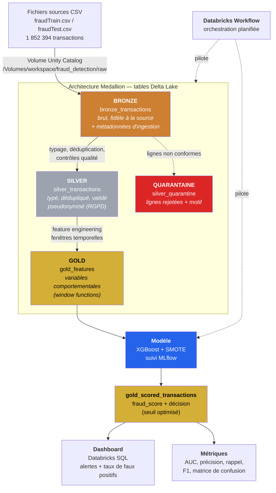

# Architecture de la plateforme

## Vue d'ensemble

## Rôle de chaque couche

| Couche | Table | Responsabilité | Ce qu'on s'interdit d'y faire |
|---|---|---|---|
| **Bronze** | `bronze_transactions` | Copie fidèle de la source + horodatage d'ingestion et nom du fichier d'origine | Aucune transformation métier. Si Bronze modifie la donnée, on perd la capacité de rejouer le pipeline après correction d'un bug. |
| **Silver** | `silver_transactions` | Typage explicite, déduplication, contrôles qualité, pseudonymisation RGPD | Aucun calcul dépendant d'autres lignes (pas d'agrégat, pas de fenêtre) : Silver reste une transformation ligne à ligne, donc rejouable partiellement. |
| **Quarantaine** | `silver_quarantine` | Journal des lignes rejetées avec leur motif | Rien n'est supprimé silencieusement : un taux de rejet est une métrique, pas un détail d'implémentation. |
| **Gold** | `gold_features` | Variables comportementales calculées par fenêtres temporelles | Aucune information postérieure à la transaction courante (voir « fuite temporelle » ci-dessous). |
| **Gold scoré** | `gold_scored_transactions` | Score du modèle + décision selon le seuil retenu | — |

## Décisions d'architecture

### 1. Pourquoi Delta Lake et pas du Parquet simple

Trois propriétés dont le pipeline dépend réellement :

- **Transactions ACID** — une écriture interrompue ne laisse pas une table à moitié écrite. Sans cela, un job planté à 3 h du matin corrompt la table Gold et fausse le dashboard du lendemain.
- **Time travel** — on peut relire l'état exact d'une table à la version *n*. C'est ce qui rend une évaluation de modèle reproductible : on sait sur quelles données précises le run MLflow a été entraîné.
- **Évolution de schéma** — l'ajout d'une colonne de feature ne casse pas les lectures existantes.

### 2. Pourquoi une table de quarantaine plutôt qu'un filtre

Un `WHERE amt > 0` qui écarte des lignes est invisible : personne ne saura jamais combien de transactions ont disparu ni pourquoi. En redirigeant les lignes non conformes vers une table dédiée avec un motif de rejet, le taux de rejet devient une **métrique de qualité mesurable et présentable**.

### 3. La contrainte structurante : pas de fuite temporelle

C'est la règle qui gouverne toute la couche Gold.

Une variable comme « montant moyen historique du client » se calcule sur une fenêtre. Si cette fenêtre inclut la transaction courante, on injecte dans les variables explicatives une information qui n'existait pas au moment de la décision. Le modèle affiche alors des performances excellentes en évaluation et s'effondre en production.

Toutes les fenêtres du projet sont donc bornées à `rowsBetween(..., -1)` — strictement les transactions *antérieures* du même client, jamais la courante.

Conséquence assumée : les premières transactions de chaque client n'ont pas d'historique et produisent des valeurs nulles. On les traite explicitement plutôt que de les masquer.

### 4. Pourquoi le split train/test est temporel

En fraude, l'évaluation doit répondre à : « le modèle entraîné sur le passé détecte-t-il la fraude de demain ? ». Un split aléatoire entraînerait le modèle sur des transactions postérieures à celles du test — un scénario impossible en production, qui surestime les performances.

Le jeu de données fournit déjà cette séparation : `fraudTrain.csv` s'arrête le 21/06/2020 à 12:13:37 et `fraudTest.csv` reprend à 12:14:25, **sans aucun chevauchement**. Cette coupure est conservée telle quelle.

### 5. Ordre imposé : features → split → SMOTE

L'ordre n'est pas négociable, chaque inversion crée une fuite :

1. **Features d'abord** — elles se calculent sur l'historique réel et continu de chaque client.
2. **Split ensuite** — sur la date de coupure.
3. **SMOTE en dernier, sur le train uniquement** — SMOTE crée des transactions synthétiques. En mettre dans le jeu de test reviendrait à évaluer le modèle sur des fraudes inventées.

## Stack technique

| Couche | Techno | Rôle |
|---|---|---|
| Plateforme | Databricks Free Edition (serverless) | Environnement Spark managé, Unity Catalog |
| Traitement | PySpark | Nettoyage, jointures, agrégations |
| Stockage | Delta Lake | Tables Bronze/Silver/Gold, ACID, time travel |
| Feature eng. | Spark SQL / window functions | Variables comportementales |
| Modèle | XGBoost + SMOTE (imbalanced-learn) | Scoring fraude |
| Comparaison | Régression logistique, LightGBM | Justification du modèle retenu |
| Explicabilité | SHAP | Interprétation des décisions |
| Suivi modèle | MLflow | Versionnage, métriques, Model Registry |
| Orchestration | Databricks Workflows | Enchaînement Bronze→Silver→Gold→scoring |
| Restitution | Databricks SQL Dashboard | Alertes + KPI taux de faux positifs |
| Versionnage | Git / GitHub | Code et notebooks |
